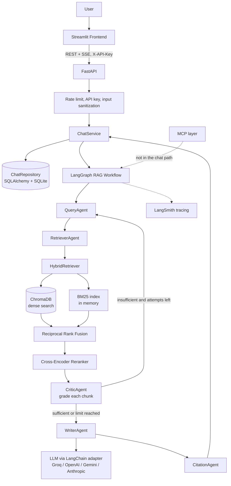
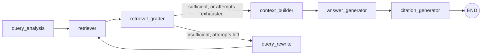
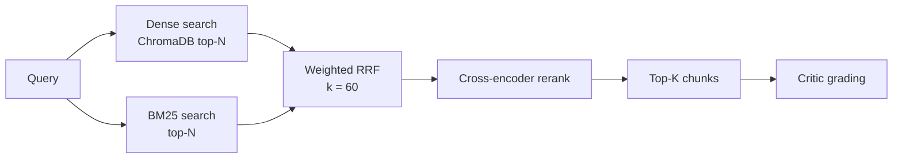

<div align="center">

# Enterprise Knowledge Assistant (RAG)

### Source-grounded question answering with hybrid retrieval, reranking, and a self-correcting multi-agent workflow

Built with Clean Architecture. Runs on a laptop: CPU-only, or alongside a 4 GB GPU that it never needs.


</div>

---

## Table of Contents

- [Overview](#overview)
- [Problem Statement](#problem-statement)
- [The Solution](#the-solution)
- [Who Is It For](#who-is-it-for)
- [Key Features](#key-features)
- [Architecture](#architecture)
- [How a Question Is Answered](#how-a-question-is-answered)
- [The Agents](#the-agents)
- [Ingestion Pipeline](#ingestion-pipeline)
- [Retrieval Pipeline](#retrieval-pipeline)
- [Streaming](#streaming)
- [Technology Stack](#technology-stack)
- [Dependencies](#dependencies)
- [MCP Integration](#mcp-integration)
- [Security](#security)
- [Observability](#observability)
- [API Reference](#api-reference)
- [Frontend](#frontend)
- [Project Structure](#project-structure)
- [Getting Started](#getting-started)
- [Configuration](#configuration)
- [Docker](#docker)
- [Testing, Linting, and CI](#testing-linting-and-ci)
- [Scaling to Production](#scaling-to-production)
- [Known Limitations](#known-limitations)
- [AI-Assisted Development](#ai-assisted-development)
- [Author](#author)

---

## Overview

Enterprise Knowledge Assistant is a **Retrieval-Augmented Generation (RAG)** system. You upload documents, ask questions in natural language, and get answers **grounded only in those documents, with citations**. If the documents don't contain the answer, it says so instead of guessing.

What goes beyond a basic RAG demo:

- **Hybrid retrieval:** dense vectors and BM25, merged with Reciprocal Rank Fusion, then re-scored by a cross-encoder.
- **Self-correction:** a Critic agent grades every retrieved chunk. If the evidence is too weak, the Query agent rewrites the question and retrieval runs again.
- **Deterministic citations:** citations are built from retrieval metadata, never written by the LLM, so they cannot be fabricated.
- **Swappable providers:** Groq by default, plus OpenAI, Gemini, and Anthropic through one adapter.
- **Clean Architecture:** every external dependency (LLM, vector store, database, embeddings, reranker) sits behind an interface in `app/core/interfaces/`.
- **Production habits:** API-key auth, rate limiting, upload validation, structured logging, LangSmith tracing, tests, Docker, and CI.

The goal is production-style architecture on laptop-scale infrastructure, not large-scale distributed deployment.

---

## Problem Statement

Organizations keep their knowledge in documents: policies, handbooks, reports, contracts, spreadsheets, and exported data. Finding a specific answer in that pile is slow, and the obvious AI shortcut creates new problems.

| Problem | Why it hurts |
|---|---|
| **Information is buried** | People skim dozens of pages or ask a colleague for what a document already says |
| **Keyword search misses meaning** | Searching for "time off" will not find a section titled "annual leave entitlement" |
| **Semantic search alone misses exact terms** | Embeddings are weak on policy codes, SKUs, names, and acronyms |
| **Chatbots hallucinate** | A general LLM will confidently invent policies, numbers, and sources |
| **Answers can't be verified** | Without citations, nobody can check where an answer came from |
| **Weak retrieval goes unnoticed** | Many RAG demos answer from whatever they found, even if it is irrelevant |
| **Company data must stay controlled** | Teams need access control, upload limits, and an audit trail, not a public chat window |

## The Solution

Enterprise Knowledge Assistant answers questions **only from your own documents** and shows its sources:

- **Finds the right passages** by combining meaning-based search with exact keyword search, then re-ranking the results.
- **Checks its own evidence.** If the retrieved passages are not relevant, it rewrites the question and tries once more.
- **Refuses to guess.** If the documents don't contain the answer, it says "I don't know based on the available documents."
- **Cites everything.** Each answer lists the file, page, and a snippet, generated from retrieval data rather than by the model.
- **Remembers the conversation,** so follow-up questions work naturally.
- **Runs locally** on a laptop with no GPU, using any of four LLM providers.

---

## Who Is It For

| Audience | How they use it |
|---|---|
| **Employees and new hires** | Ask about HR policies, onboarding steps, benefits, and internal procedures instead of searching shared drives |
| **Support and operations teams** | Find answers in manuals, SOPs, and runbooks, with a page reference to confirm |
| **Legal, compliance, and finance staff** | Look up clauses, requirements, and figures across contracts and reports, with traceable sources |
| **Analysts and researchers** | Query collections of reports, CSV exports, and JSON data in plain language |
| **Engineering and product teams** | Search technical documentation and specs; optionally extend with GitHub and Notion through the MCP layer |
| **AI and software engineers** | A reference implementation of production-style RAG: Clean Architecture, hybrid retrieval, LangGraph, tracing, tests, and CI |
| **Students and portfolio reviewers** | A complete, readable example of an end-to-end GenAI application that runs on modest hardware |

**Typical questions it handles**

- "What is our leave policy for new employees?"
- "Which section of the contract covers termination notice?"
- "Summarize the key risks mentioned in the Q3 report."
- "What does error code HR-114 mean?" (exact-term matching through BM25)
- A follow-up such as "And what about part-time staff?" in the same conversation

**Not designed for:** multi-tenant SaaS with per-user permissions, very large corpora (millions of chunks), or answering questions that need knowledge outside the uploaded documents.

---

## Key Features

| Area | What it does |
|---|---|
| **File types** | PDF, DOCX, TXT, Markdown, CSV, JSON |
| **Chunking** | Three strategies: recursive (default), fixed, overlap. Defaults: 800 characters, 120 overlap |
| **Retrieval** | Dense (ChromaDB, cosine) + BM25 + weighted RRF (60% dense / 40% BM25 by default) |
| **Reranking** | `cross-encoder/ms-marco-MiniLM-L-6-v2` over a widened candidate set |
| **Grading** | LLM relevance check per chunk, with one query-rewrite retry |
| **Answering** | Strict "context only" prompt; fixed "I don't know" fallback with no LLM call when nothing relevant is found |
| **Citations** | Filename, page, chunk ID, and a 160-character snippet, deduplicated per file and page |
| **Memory** | Conversations stored in SQLite; the last 6 messages feed each follow-up |
| **Streaming** | Server-Sent Events: `token` events, then a final `done` event with citations |
| **LLM providers** | Groq (default), OpenAI, Gemini, Anthropic, chosen by one environment variable |
| **Frontend** | Streamlit app: chat, upload, history, settings, metrics |
| **Extensibility** | MCP layer for filesystem, SQLite, GitHub, Notion |

---

## Architecture



**Layering.** Domain models (`app/core/domain`) and interfaces (`app/core/interfaces`) know nothing about FastAPI, ChromaDB, or SQLAlchemy. Concrete implementations live in `app/rag`, `app/repositories`, `app/embeddings`, `app/reranker`, and `app/services/llm`, and are wired together in `app/api/dependencies.py`.

| Interface (port) | Current implementation (adapter) |
|---|---|
| `VectorStore` | `ChromaVectorStore` |
| `EmbeddingProvider` | `SentenceTransformerEmbeddingProvider` |
| `Reranker` | `CrossEncoderReranker` |
| `LLMProvider` | `LangChainLLMAdapter` (wraps ChatGroq, ChatOpenAI, ChatGoogleGenerativeAI, ChatAnthropic) |
| `DocumentRepository`, `ChatRepository` | `SQLiteDocumentRepository`, `SQLiteChatRepository` |

---

## How a Question Is Answered

The compiled LangGraph workflow has seven nodes:



1. **query_analysis:** light normalization of the question (a hook for future intent or PII handling).
2. **retriever:** hybrid search plus reranking.
3. **retrieval_grader:** the Critic asks the LLM whether each chunk is `relevant` or `irrelevant`. Evidence is "sufficient" if at least one chunk survives.
4. **Conditional edge:** if evidence is insufficient and attempts remain, go to **query_rewrite**, which produces a short keyword-rich query, then retrieve again. `max_retrieval_attempts` is 2, so there is at most one retry and no infinite loops.
5. **context_builder:** a named pass-through stage so traces show it clearly.
6. **answer_generator:** the Writer answers from the graded chunks, or returns the fixed fallback.
7. **citation_generator:** citations come straight from the graded chunks' metadata.

Around the graph, `ChatService` loads the last 6 messages for follow-ups, saves the user message and the assistant reply (with citations), and records latency.

---

## The Agents

| Agent | File | Responsibility |
|---|---|---|
| **QueryAgent** | `app/agents/query_agent.py` | Normalizes the query; rewrites it with the LLM when the first retrieval was weak |
| **RetrieverAgent** | `app/agents/retriever_agent.py` | Pulls `max(top_k × 3, top_k + 5)` hybrid candidates, then reranks down to `top_k` |
| **CriticAgent** | `app/agents/critic_agent.py` | Grades each chunk with the LLM (temperature 0) and decides whether the set is sufficient |
| **WriterAgent** | `app/agents/writer_agent.py` | Generates the answer (blocking or streamed); skips the LLM entirely if no chunk passed grading |
| **CitationAgent** | `app/agents/citation_agent.py` | Builds `Citation` objects from retrieval metadata. Deliberately not LLM-based |

---

## Ingestion Pipeline


- **Extraction** (`app/rag/extraction/`): `pypdf` for PDFs (page-aware), `python-docx` for DOCX, plain readers for TXT and Markdown, CSV grouped 50 rows per pseudo-page, and a JSON extractor. A factory picks the extractor by file extension.
- **Cleaning** (`app/rag/cleaning.py`): Unicode NFKC normalization, control-character removal, PDF hyphenated line-break repair, whitespace collapsing. It never lowercases or stems, because the LLM needs original text.
- **Chunking** (`app/rag/chunking/`): `recursive` (paragraph, then line, then sentence, then word boundaries), `fixed`, or `overlap`, selected by `CHUNK_STRATEGY`.
- **Embedding:** `sentence-transformers/all-MiniLM-L6-v2` on CPU, normalized so dot product equals cosine similarity.
- **Storage:** ChromaDB `PersistentClient` with a cosine HNSW index. Chunk metadata includes document ID, filename, page, chunk index, and upload time.
- **Status tracking:** each document moves through `uploaded`, `processing`, `indexed`, or `failed` (with an error message) in SQLite.
- **Deletion:** removes the document's vectors and its database row, then rebuilds the BM25 index.

---

## Retrieval Pipeline



1. **Dense:** the query is embedded and searched in ChromaDB, with an optional `document_ids` metadata filter.
2. **BM25:** `rank-bm25` (`BM25Okapi`) over an in-memory index with a simple alphanumeric tokenizer. This catches exact terms that embeddings miss, such as policy codes and SKUs. The index is rebuilt after every ingest or delete, which takes milliseconds at laptop scale.
3. **Fusion:** Reciprocal Rank Fusion with `k = 60`: `score = weight / (60 + rank)`, summed across lists, with weights from `DENSE_WEIGHT` and `BM25_WEIGHT`. RRF uses rank positions only, so it avoids normalizing cosine scores against unbounded BM25 scores.
4. **Rerank:** the cross-encoder scores each (query, chunk) pair jointly for higher precision, then keeps `top_k`.
5. **Scores kept:** each result carries `dense_score`, `bm25_score`, `fused_score`, and `rerank_score`.

Set `HYBRID_SEARCH_ENABLED=false` to use dense search only.

---

## Streaming

With `stream: true` (the default), `POST /chat` returns Server-Sent Events:

| Event | Payload | Purpose |
|---|---|---|
| `token` | `{"delta": "..."}` | Incremental answer text |
| `done` | `{"conversation_id": "...", "citations": [...]}` | Sent once, after the full answer exists |

Citations arrive last because the full set is only known once the answer is complete.

The streaming path calls the agents directly (retrieve, grade, optional rewrite, stream the write) with the same retry-once policy as the graph. The non-streaming path (`stream: false`) runs through the compiled LangGraph and returns a single JSON `ChatResponse`.

---

## Technology Stack

| Layer | Technology |
|---|---|
| **LLM (default)** | Groq, model `llama-3.3-70b-versatile` |
| **LLM (optional)** | OpenAI, Google Gemini, Anthropic |
| **Orchestration** | LangGraph |
| **Vector database** | ChromaDB (embedded, persistent) |
| **Embeddings** | sentence-transformers, `all-MiniLM-L6-v2` (384-dim, CPU) |
| **Reranker** | sentence-transformers CrossEncoder, `ms-marco-MiniLM-L-6-v2` |
| **Keyword search** | rank-bm25 |
| **Backend** | FastAPI, Uvicorn |
| **Frontend** | Streamlit |
| **Relational storage** | SQLAlchemy 2.0 (async), aiosqlite, SQLite |
| **Rate limiting** | slowapi |
| **Logging** | structlog |
| **Tracing** | LangSmith |
| **Config** | pydantic-settings, python-dotenv |
| **Testing** | pytest, pytest-asyncio, pytest-cov |
| **Code quality** | Black, Ruff (line length 115, Python 3.12 target) |
| **Containers / CI** | Docker (multi-stage), GitHub Actions |

---

## Dependencies

Versions are pinned in `requirements.txt`.

| Category | Package | Version | Used for |
|---|---|---|---|
| **Web** | fastapi | 0.115.6 | REST API |
| | uvicorn[standard] | 0.34.0 | ASGI server |
| | pydantic | 2.10.4 | Domain models, request validation |
| | pydantic-settings | 2.7.1 | Environment-based settings |
| | python-multipart | 0.0.20 | File uploads |
| | slowapi | 0.1.9 | Rate limiting |
| **Frontend** | streamlit | 1.41.1 | Multipage UI |
| **LangChain ecosystem** | langchain-core | 0.3.29 | Message types, chat model interface |
| | langchain-groq | 0.2.3 | Groq chat model |
| | langchain-openai | 0.2.14 | OpenAI chat model |
| | langchain-google-genai | 2.0.8 | Gemini chat model |
| | langchain-anthropic | 0.3.3 | Anthropic chat model |
| | langgraph | 0.2.62 | Workflow graph |
| | langsmith | 0.2.10 | Tracing |
| **Embeddings / rerank** | sentence-transformers | 3.3.1 | Embeddings and cross-encoder |
| **Vector DB** | chromadb | 0.5.23 | Vector storage and search |
| **Retrieval** | rank-bm25 | 0.2.2 | BM25 |
| **Documents** | pypdf | 5.1.0 | PDF text extraction |
| | python-docx | 1.1.2 | DOCX text extraction |
| **Database** | sqlalchemy | 2.0.36 | Async ORM |
| | aiosqlite | 0.20.0 | SQLite async driver |
| **MCP** | mcp | 1.1.2 | MCP client SDK |
| **Utilities** | python-dotenv | 1.0.1 | `.env` loading |
| | structlog | 24.4.0 | Structured logging |
| **Testing** | pytest | 8.3.4 | Test runner |
| | pytest-asyncio | 0.25.1 | Async tests |
| | pytest-cov | 6.0.0 | Coverage |
| **Code quality** | black | 24.10.0 | Formatting |
| | ruff | 0.8.4 | Linting |

**Declared but not yet used in the code:** `langchain`, `langchain-community`, `unstructured`, `markdown`, `alembic`, `tenacity`, `httpx`. They are reserved for planned work such as database migrations, retry policies, and richer document parsing. The Streamlit frontend also imports `requests`, which is not pinned directly and currently arrives as a transitive dependency.

**Models** are downloaded from Hugging Face on first run and cached locally:

| Model | Role | Size |
|---|---|---|
| `sentence-transformers/all-MiniLM-L6-v2` | Embeddings | small, CPU-friendly |
| `cross-encoder/ms-marco-MiniLM-L-6-v2` | Reranking | about 90 MB |

---

## MCP Integration

A modular **Model Context Protocol** layer (`app/mcp/`) describes and launches external tool servers over stdio:

| Server | Launch | Enabled when |
|---|---|---|
| Filesystem | `npx @modelcontextprotocol/server-filesystem` | Always (scoped to `MCP_FILESYSTEM_ROOT`) |
| SQLite | `uvx mcp-server-sqlite` | Always (points at the app's own database) |
| GitHub | `npx @modelcontextprotocol/server-github` | `MCP_GITHUB_TOKEN` is set |
| Notion | `npx @modelcontextprotocol/server-notion` | `MCP_NOTION_TOKEN` is set |

- `registry.py` declares each server as an `MCPServerSpec`; `register_server()` adds new ones without touching the client.
- `client.py` wraps the official SDK with `list_server_tools()` and `call_server_tool()`.
- Server status appears in the `/metrics` response and on the Streamlit Settings page.

> **Important:** the MCP layer is **infrastructure only**. It is **not invoked during the standard chat pipeline**. It is the foundation for future agent tool-calling. Running these servers requires Node.js (for `npx`) or `uv` (for `uvx`).

---

## Security

| Control | Implementation |
|---|---|
| **Authentication** | `X-API-Key` header checked against `BACKEND_API_KEY` on `/upload`, `/documents`, `/chat`, `/history` |
| **Rate limiting** | slowapi, per client IP: 30/minute on `/chat`, 10/minute on `/upload`, plus a global default from `RATE_LIMIT_PER_MINUTE` |
| **Upload validation** | Extension allow-list, real size check after reading (not the `Content-Length` header), empty-file rejection, 20 MB default limit |
| **Query sanitization** | Control characters stripped, length capped at 2000 characters |
| **Prompt-injection signals** | Common override phrases are flagged in logs for auditing, not blocked |
| **Prompt contract** | The system prompt restricts the model to the provided context and forbids invented sources |
| **Citations** | Built from metadata, so they cannot be fabricated by the model |
| **Error handling** | A global handler returns a generic 500 and logs details server-side |
| **CORS** | Origins restricted via `CORS_ALLOWED_ORIGINS` |
| **Secrets** | `.env` is git-ignored and excluded from Docker builds |
| **Container** | Runs as a non-root user with a health check |

`/health` and `/metrics` do not require an API key. The auth model is a single shared key, suited to a single-tenant or internal deployment. Use OAuth2/JWT for multi-user needs.

---

## Observability

- **LangSmith:** traces graph runs end to end (retrieval, grading, prompts, LLM calls, latency, token usage). `configure_langsmith()` copies the `LANGCHAIN_*` settings into `os.environ`, which LangChain reads directly. Tracing is enabled only when both `LANGCHAIN_TRACING_V2=true` and an API key are present.
- **structlog:** colorized console output in development, JSON in other environments (`APP_ENV`). Every graph node logs its progress, and each handled chat logs `chat_handled` with `conversation_id` and `latency_ms`.
- **`/metrics` endpoint and dashboard page:** document counts by status, total chunks indexed, vectors in the store, and MCP server status.
- Every `ChatResponse` includes `retrieval_count` and `latency_ms`.

---

## API Reference

Interactive docs: `http://localhost:8000/docs`. Authenticated routes need the `X-API-Key` header.

| Method | Endpoint | Auth | Description |
|---|---|---|---|
| `GET` | `/health` | No | Liveness check |
| `GET` | `/metrics` | No | Document, chunk, vector, and MCP status |
| `POST` | `/upload` | Yes | Upload and index a document (10/min) |
| `GET` | `/documents` | Yes | List documents and their status |
| `DELETE` | `/documents/{document_id}` | Yes | Delete a document and its vectors |
| `POST` | `/chat` | Yes | Ask a question, streamed or not (30/min) |
| `GET` | `/history` | Yes | List conversations, or fetch one with `?conversation_id=` |

**Chat request body**

```json
{
  "query": "What is the leave policy for new employees?",
  "conversation_id": null,
  "document_ids": null,
  "top_k": 10,
  "stream": false
}
```

`conversation_id` continues an existing conversation. `document_ids` restricts search to specific documents. `stream` defaults to `true`.

**Examples**

```bash
# Upload
curl -X POST http://localhost:8000/upload \
  -H "X-API-Key: $BACKEND_API_KEY" \
  -F "file=@handbook.pdf"

# Ask (single JSON response)
curl -X POST http://localhost:8000/chat \
  -H "X-API-Key: $BACKEND_API_KEY" \
  -H "Content-Type: application/json" \
  -d '{"query": "Summarize the key policies.", "stream": false}'

# Ask (stream tokens)
curl -N -X POST http://localhost:8000/chat \
  -H "X-API-Key: $BACKEND_API_KEY" \
  -H "Content-Type: application/json" \
  -d '{"query": "Summarize the key policies."}'
```

**Non-streaming response**

```json
{
  "conversation_id": "…",
  "answer": "… [handbook.pdf, page 4]",
  "citations": [
    { "filename": "handbook.pdf", "page": 4, "chunk_id": "…", "snippet": "…" }
  ],
  "retrieval_count": 3,
  "latency_ms": 1840.2
}
```

---

## Frontend

A Streamlit multipage app in `frontend/`. All backend calls go through `frontend/api_client.py`.

| Page | Purpose |
|---|---|
| **Chat** (`app.py`) | Streaming chat, optional "search only within" document filter, new-conversation button, expandable source list |
| **Upload Documents** | Upload files, see status and chunk counts, delete documents |
| **Conversation History** | Browse past conversations with their citations |
| **Settings** | Backend health, per-session `top_k`, LangSmith link, MCP server status |
| **Retrieval Metrics** | Document, chunk, and vector counts with a status chart |

The frontend reads `BACKEND_URL` (default `http://localhost:8000`) and `BACKEND_API_KEY` from the environment.

---

## Project Structure

```text
NexusAI-Enterprise/
├── app/
│   ├── main.py                     # FastAPI app factory, lifespan, middleware
│   ├── agents/                     # Query, Retriever, Critic, Writer, Citation
│   ├── api/
│   │   ├── dependencies.py         # Dependency wiring (DI container)
│   │   ├── middleware/             # API key, rate limit, file validation, input sanitization
│   │   └── routes/                 # health, metrics, upload, documents, chat, history
│   ├── core/
│   │   ├── config/                 # settings, logging, LangSmith setup
│   │   ├── domain/                 # Pydantic domain models
│   │   └── interfaces/             # Ports: LLM, embeddings, vector store, reranker, repositories
│   ├── embeddings/                 # sentence-transformers provider
│   ├── graph/                      # LangGraph state, nodes, workflow
│   ├── mcp/                        # MCP registry and client
│   ├── prompts/                    # Answer, grading, and rewrite prompts
│   ├── rag/
│   │   ├── chunking/               # recursive, fixed, overlap + factory
│   │   ├── extraction/             # pdf, docx, text, csv, json + factory
│   │   ├── cleaning.py
│   │   └── vector_store/           # ChromaDB store
│   ├── repositories/               # SQLAlchemy engine/models, SQLite repositories
│   ├── reranker/                   # Cross-encoder reranker
│   ├── retrieval/                  # BM25, RRF, hybrid retriever
│   └── services/                   # ChatService, IngestionService, LLM factory + adapter
├── frontend/                       # Streamlit app, pages, API client
├── tests/                          # unit/ and integration/
├── docker/                         # Dockerfile, docker-compose.yml
├── docs/ARCHITECTURE.md            # Design rationale
├── .github/workflows/ci.yml
├── .env.example
├── pyproject.toml                  # Black and Ruff config
├── pytest.ini
└── requirements.txt
```

---

## Getting Started

### Prerequisites

- Python 3.12
- Git
- A Groq API key from [console.groq.com](https://console.groq.com) (or a key for another provider)
- Optional: a [LangSmith](https://smith.langchain.com) key for tracing
- Optional: Node.js and `uv` if you plan to run MCP servers

### Install

```bash
git clone https://github.com/Rizwana200/NexusAI-Enterprise.git
cd NexusAI-Enterprise

python3.12 -m venv venv
source venv/bin/activate          # Windows: venv\Scripts\activate

# CPU-only PyTorch first (avoids multi-GB CUDA downloads)
pip install torch --index-url https://download.pytorch.org/whl/cpu
pip install -r requirements.txt

cp .env.example .env              # then add your keys
```

Set at least `GROQ_API_KEY` and a strong `BACKEND_API_KEY` in `.env`.

### Run the backend

```bash
uvicorn app.main:app --reload --port 8000
```

Tables are created automatically at startup. Swagger docs: http://localhost:8000/docs. The first request downloads the embedding and reranker models.

### Run the frontend

In a second terminal, with `BACKEND_API_KEY` set to the same value as the backend:

```bash
export BACKEND_API_KEY=your-key   # Windows PowerShell: $env:BACKEND_API_KEY="your-key"
streamlit run frontend/app.py
```

Open http://localhost:8501.

### Try it

1. Open **Upload Documents** and upload a PDF or DOCX.
2. On the chat page, ask a question and watch the answer stream in.
3. Expand the sources under the answer to see the cited files, pages, and snippets.
4. Ask something unrelated and confirm it replies "I don't know based on the available documents."
5. Ask a follow-up to see conversation memory at work.

---

## Configuration

Settings load from `.env` through pydantic-settings (`app/core/config/settings.py`).

| Group | Variable | Default | Purpose |
|---|---|---|---|
| **App** | `APP_NAME` | Enterprise RAG Assistant | API title |
| | `APP_ENV` | development | `development` gives console logs; anything else gives JSON |
| | `DEBUG` | true | Debug flag |
| | `LOG_LEVEL` | INFO | Log verbosity |
| **LLM** | `LLM_PROVIDER` | groq | `groq`, `openai`, `gemini`, or `anthropic` |
| | `LLM_MODEL` | llama-3.3-70b-versatile | Model name for the chosen provider |
| | `LLM_TEMPERATURE` | 0.1 | Default sampling temperature |
| | `LLM_MAX_TOKENS` | 1024 | Default output limit |
| | `GROQ_API_KEY`, `OPENAI_API_KEY`, `GEMINI_API_KEY`, `ANTHROPIC_API_KEY` | empty | Provider credentials |
| **Embeddings** | `EMBEDDING_MODEL` | sentence-transformers/all-MiniLM-L6-v2 | Embedding model |
| | `EMBEDDING_DEVICE` | cpu | `cpu` or `cuda` |
| | `EMBEDDING_BATCH_SIZE` | 32 | Encoding batch size |
| **Reranker** | `RERANKER_MODEL` | cross-encoder/ms-marco-MiniLM-L-6-v2 | Cross-encoder model |
| | `RERANKER_DEVICE` | cpu | `cpu` or `cuda` |
| | `RERANKER_TOP_K` | 5 | Reserved setting |
| **Vector store** | `CHROMA_PERSIST_DIR` | ./data/chroma | ChromaDB storage path |
| | `CHROMA_COLLECTION_NAME` | enterprise_docs | Collection name |
| **Database** | `DATABASE_URL` | sqlite+aiosqlite:///./data/app.db | SQLAlchemy URL |
| **Chunking** | `CHUNK_STRATEGY` | recursive | `recursive`, `fixed`, or `overlap` |
| | `CHUNK_SIZE` | 800 | Characters per chunk |
| | `CHUNK_OVERLAP` | 120 | Overlap between chunks |
| **Retrieval** | `RETRIEVAL_TOP_K` | 10 | Default chunks to keep |
| | `HYBRID_SEARCH_ENABLED` | true | Dense + BM25, or dense only |
| | `DENSE_WEIGHT` / `BM25_WEIGHT` | 0.6 / 0.4 | RRF weights |
| | `SIMILARITY_THRESHOLD` | 0.3 | Reserved setting |
| **LangSmith** | `LANGCHAIN_TRACING_V2` | true | Enable tracing (needs a key) |
| | `LANGCHAIN_API_KEY` | empty | LangSmith key |
| | `LANGCHAIN_PROJECT` | enterprise-rag | Project name |
| **Security** | `BACKEND_API_KEY` | change-me-to-a-random-secret | Shared API key. **Change this** |
| | `RATE_LIMIT_PER_MINUTE` | 30 | Global default rate limit |
| | `MAX_UPLOAD_SIZE_MB` | 20 | Upload size cap |
| | `ALLOWED_FILE_EXTENSIONS` | .pdf,.docx,.txt,.md,.csv,.json | Upload allow-list |
| | `CORS_ALLOWED_ORIGINS` | http://localhost:8501,http://localhost:3000 | Allowed browser origins |
| **MCP** | `MCP_FILESYSTEM_ROOT` | ./data/mcp_files | Filesystem server root |
| | `MCP_GITHUB_TOKEN`, `MCP_NOTION_TOKEN` | empty | Enable those servers |

Never commit `.env` or API keys. To use a different LLM, set `LLM_PROVIDER`, `LLM_MODEL`, and the matching API key.

---

## Docker

The image is a multi-stage build on `python:3.12-slim` that installs CPU-only PyTorch, runs as a non-root user, and exposes a `/health` check.

**Compose (backend + frontend):**

```bash
cp .env.example .env              # at the repository root
docker compose -f docker/docker-compose.yml up --build
```

- Backend: http://localhost:8000
- Frontend: http://localhost:8501 (waits for the backend to be healthy)
- A named volume (`rag_data`) persists ChromaDB vectors and the SQLite database across restarts.

**Backend only:**

```bash
docker build -f docker/Dockerfile -t enterprise-rag-backend .
docker run --env-file .env -p 8000:8000 -v rag_data:/app/data enterprise-rag-backend
```

---

## Testing, Linting, and CI

```bash
pytest tests/ -v --cov=app --cov-report=term-missing
black --check app/ tests/
ruff check app/ tests/
```

The suite has about 30 tests:

| Type | Coverage |
|---|---|
| **Unit** | BM25 ranking, RRF fusion, chunking, text cleaning, citation building, LangSmith setup |
| **Integration** | Health, API-key enforcement, upload validation and ingestion, chat, document listing and deletion, history |

**GitHub Actions** (`.github/workflows/ci.yml`) runs on pushes and pull requests to `main` and `develop`:

1. **test:** installs CPU-only PyTorch and the requirements, runs pytest with coverage, and uploads `coverage.xml`.
2. **lint:** Black and Ruff checks.
3. **docker-build:** builds the image to verify it compiles (after test and lint pass). The image is not pushed.

---

## Scaling to Production

| Local component | Production replacement |
|---|---|
| SQLite (`aiosqlite`) | PostgreSQL: change `DATABASE_URL`; the repositories use standard SQLAlchemy calls |
| Embedded ChromaDB | Qdrant or Pinecone: implement the `VectorStore` interface and change one wiring function |
| In-memory BM25 index | A persistent search index (for example OpenSearch) |
| Single Uvicorn process | Multiple workers behind a load balancer |
| In-process rate limiting | Redis-backed limits |
| Shared API key | OAuth2 / JWT with per-user access |

---

## Known Limitations

- **Single-instance by design:** SQLite and embedded ChromaDB suit one server. Multi-node deployments need PostgreSQL and a distributed vector database.
- **MCP is not in the chat path:** the integrations exist as infrastructure and are not called during chat.
- **Grading cost:** the Critic makes one LLM call per retrieved chunk, so latency and token use grow with `top_k`. The retry adds another round.
- **BM25 is in memory:** the index is rebuilt after every ingest or delete. This is fast at laptop scale but not suitable for very large corpora.
- **Conversation memory** passes the last 6 messages as raw text, not an LLM-written summary.
- **No schema migrations yet:** tables are created at startup, and Alembic is not configured.
- **Single shared API key:** there are no per-user accounts or document-level permissions.
- **Two reserved settings:** `SIMILARITY_THRESHOLD` and `RERANKER_TOP_K` are defined but not yet used by the pipeline.
- **First run downloads models** from Hugging Face before working offline.

---

## AI-Assisted Development

This project was developed using AI-assisted software engineering tools. The overall system architecture, feature requirements, implementation direction, integration, testing, and iterative refinement were guided by the project author. AI was used as a coding assistant to accelerate implementation and improve development productivity.

All code has been reviewed, integrated, and validated before publication.

---

## Author

- GitHub: [github.com/Rizwana200](https://github.com/Rizwana200)